# Self-Healing Network Security System for APTs

A closed-loop intrusion response prototype that combines **Random Forest detection**, a
**Q-learning response policy**, **response verification**, **SQLite threat memory**, and
**controlled endpoint healing verified by SHA-256**, plus a **multi-stage APT campaign
simulation** and an **offline SOC dashboard** generated from every run.

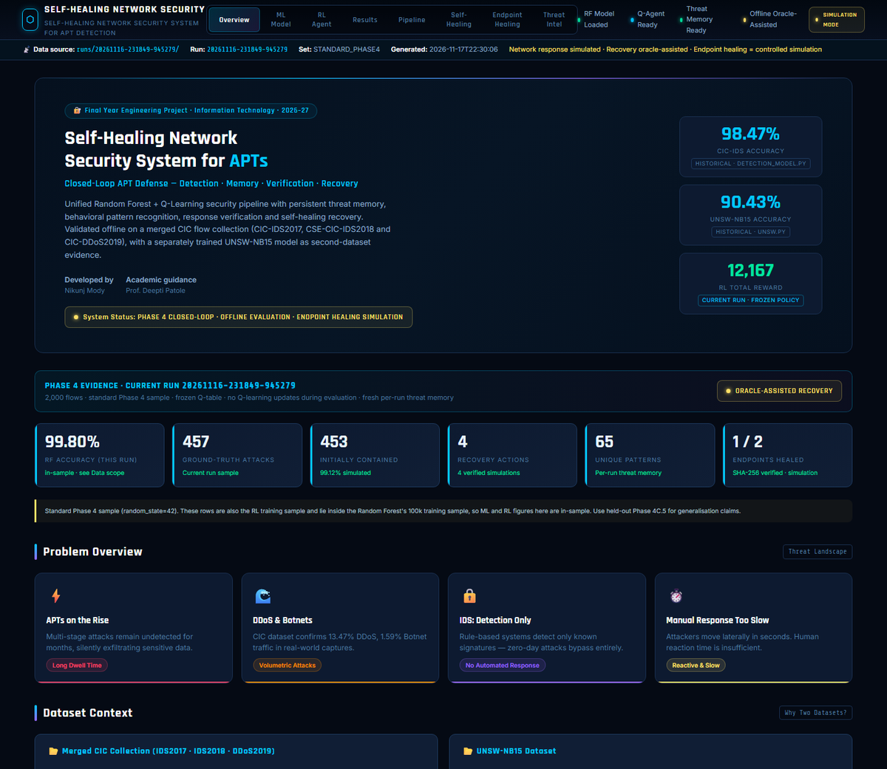

> **Scope in one line:** detection and response decisions run on real labelled network flows.
> The network response, the compromised endpoints and the lateral movement are **controlled
> simulations**. No firewall rule is applied and no real Windows machine is modified.

---

## Contents
[Problem](#problem) · [Features](#key-features) · [Architecture](#architecture) ·
[Methodology](#methodology) · [Endpoint healing](#controlled-endpoint-healing) ·
[APT simulation](#multi-stage-apt-simulation) · [Dashboard](#soc-dashboard) ·
[Installation](#installation) · [Dataset](#dataset) · [Usage](#usage) · [Database](#database) ·
[Tests](#tests) · [Results](#results) · [Limitations](#limitations-and-future-work) · [Structure](#repository-structure)

---

## Problem

Advanced Persistent Threats move through several stages (initial access, persistence, credential
access, lateral movement, impact) and can stay hidden for months. Typical ML-based intrusion
detection stops at a label. It does not choose a response, check whether the response worked, or
repair the host the attacker changed. This project explores the full loop:
**detect → decide → respond → verify → recover → remember → heal**, with every claim backed by
evidence the code produces itself.

## Key features

| Area | What is implemented |
|---|---|
| Detection | Random Forest (50 trees, 57 flow features) with class-probability confidence |
| Response policy | Tabular Q-learning: state `(prediction, confidence bucket)`, actions `ALLOW / ALERT / BLOCK`; frozen at evaluation, unseen states fall back to `ALERT` |
| Threat assessment | Threat score 0–100 and severity LOW / MEDIUM / HIGH / CRITICAL |
| Threat memory | SQLite: events, behavioural fingerprints (NEW / KNOWN / REPEATED), recovery audit, endpoint audit, APT campaign records |
| Verification | Separates *response executed* from *attack contained*; LIVE mode returns `PENDING` without evidence; `ENDPOINT_INTEGRITY` mode uses SHA-256 evidence |
| Recovery | Self-healing rules (maintain, reuse defense, escalate, isolate recommendation, SOC review) with offline, oracle-assisted recovery |
| Endpoint healing | Baseline → compromise → trust check → detect → quarantine → remove persistence → restore → **re-hash every file** |
| APT simulation | 6 MITRE ATT&CK-labelled stages across 2 simulated hosts, cross-host correlation by implant hash |
| Dashboard | 8-tab SOC dashboard generated per run, validated against the run ID, works fully offline |
| Engineering | Per-run isolated outputs, reproducible seeds, 53 automated tests |

## Architecture

### System overview

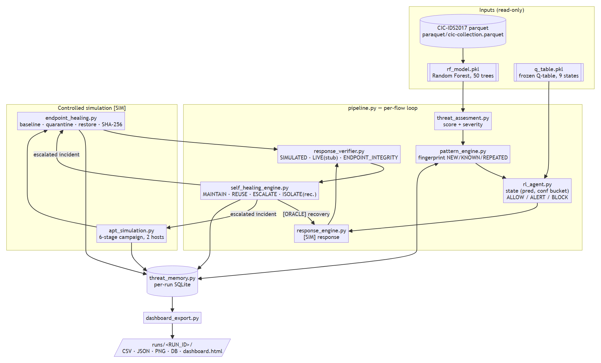

*`pipeline.py` runs each labelled flow through detection, assessment, the frozen Q-table and a
simulated response. The verifier then checks the result against ground truth after the action, and
the self-healing engine decides whether to re-execute (recovery, oracle-assisted). ESCALATE / ISOLATE
incidents trigger the controlled endpoint and APT simulations, whose SHA-256 evidence returns to the
verifier. All state goes to one SQLite file per run. Nothing here captures live traffic or enforces
firewall or endpoint changes.*

### Data flow of one run

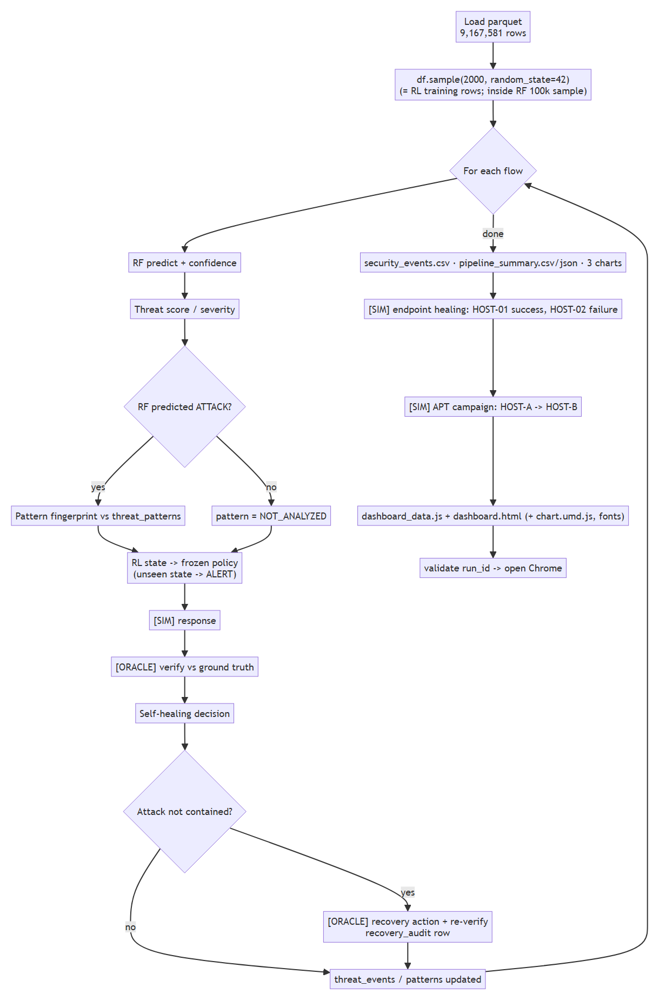

*Inputs, models and per-run outputs. Every run writes only under `runs/<RUN_ID>/`.*

## Technology stack
Python 3.14 · pandas · NumPy · scikit-learn · joblib · Matplotlib · PyArrow · SQLite ·
`hashlib` (SHA-256) · HTML/CSS/JavaScript · Chart.js 4.4.1 (bundled) · `unittest`

## Methodology

**Detection.** `RandomForestClassifier(n_estimators=50)` trained on 80 % of a 100,000-flow sample
(`training/train_random_forest.py`). Labels are binary: `Benign` = 0, any attack = 1. Confidence is
the maximum class probability.

**Threat score.** `100·c` for predicted attacks and `100·(1−c)` for benign; ≤24 LOW, ≤49 MEDIUM,
≤74 HIGH, otherwise CRITICAL.

**Response policy.** State `s = (ŷ, ⌊10c⌋)`, actions `ALLOW / ALERT / BLOCK`.

| Ground truth | BLOCK | ALERT | ALLOW |
|---|---|---|---|
| Attack | +10 | +2 | −15 |
| Benign | −10 | −2 | +5 |

The policy was trained offline with α = 0.1, γ = 0.9 and ε decaying from 1.0 to 0.05 over 30 episodes
(`training/train_q_learning.py`; each flow is a terminal decision). It is **frozen during
evaluation** (ε = 0, no Q-updates). The shipped Q-table covers 9 of the 20 possible states.

**Verification and recovery.** After the initial action, the verifier compares the response with
the ground-truth label. This oracle is available only in offline evaluation. Uncontained attacks are
escalated (BLOCK or ALERT), re-verified and written to `recovery_audit`.

**Pattern memory.** Eight flow features are binned into quartile bands. A SHA-256 fingerprint of
the behavioural signature marks threats as NEW, KNOWN or REPEATED. Repeated threats with a
previously verified containment are tagged `REUSE_DEFENSE`.

## Controlled endpoint healing

Each simulated host is a project-owned folder holding inert dummy files, a JSON configuration and a
JSON list that imitates startup persistence (`endpoint_healing.py`).

1. **Baseline:** copy of the clean state plus a SHA-256 manifest, which is itself hashed.
2. **Compromise (inert):** dropped artefact, tampered config, "encrypted" file, deleted file, rogue persistence entry.
3. **Trust check:** the manifest hash and every backup copy are verified *before* anything is restored.
4. **Detect → quarantine (move, never delete) → remove persistence → restore from trusted copies only.**
5. **Verify:** every file is re-hashed. Success requires all hashes to match and no unknown file to remain.

The demonstration runs two scenarios: an intact backup (**HEALED_VERIFIED, 5/5**) and a backup
the attacker also corrupted (**restore refused → HEALING_INCOMPLETE, 4/5 → SOC_REVIEW** with an
ISOLATE recommendation). A path guard rejects any write outside the host folder.

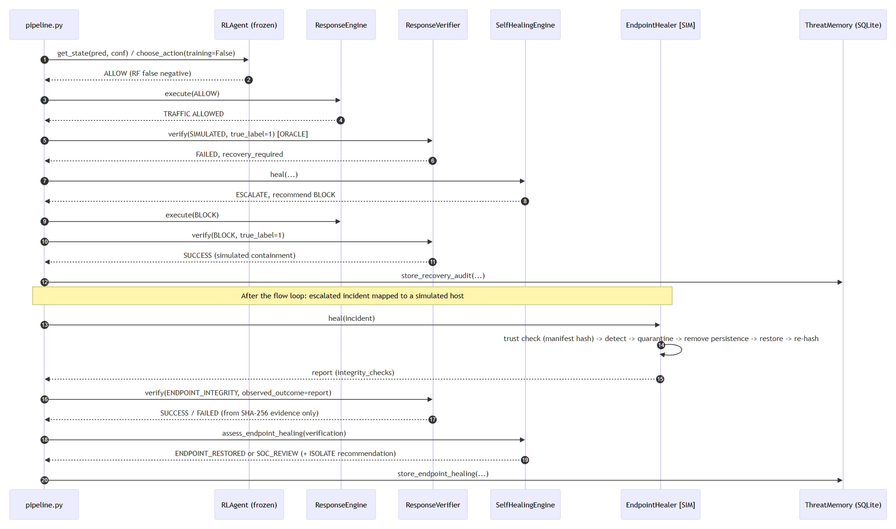

*Endpoint recovery sequence: the trust check comes before any restore, and verification re-hashes every file.*

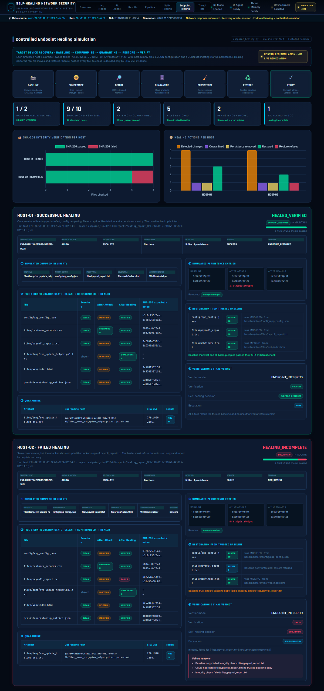

## Multi-stage APT simulation

`apt_simulation.py` runs an auditable six-stage campaign:

| # | Tactic | Host |
|---|---|---|
| 1 | TA0001 Initial Access (implant dropped) | HOST-A (workstation) |
| 2 | TA0003 Persistence | HOST-A |
| 3 | TA0006 Credential Access (dummy dump) | HOST-A |
| 4 | TA0008 Lateral Movement (*same implant copied between two sandbox folders*) | HOST-B (file server) |
| 5 | TA0003 Persistence | HOST-B |
| 6 | TA0040 Impact (file encrypted, firewall profile disabled in config) | HOST-B |

Threat memory stores the implant's SHA-256 as an IOC. When it appears on HOST-B, memory reports
it was already seen on HOST-A, which links the campaign. Both hosts are healed, and the campaign is
declared contained only if both verify **and** a final re-scan finds no IOC or rogue persistence:
`CAMPAIGN_CONTAINED_VERIFIED`. A test with a corrupted HOST-B backup yields `CAMPAIGN_NOT_CONTAINED`.
The lateral movement is simulated; the correlation logic is real.

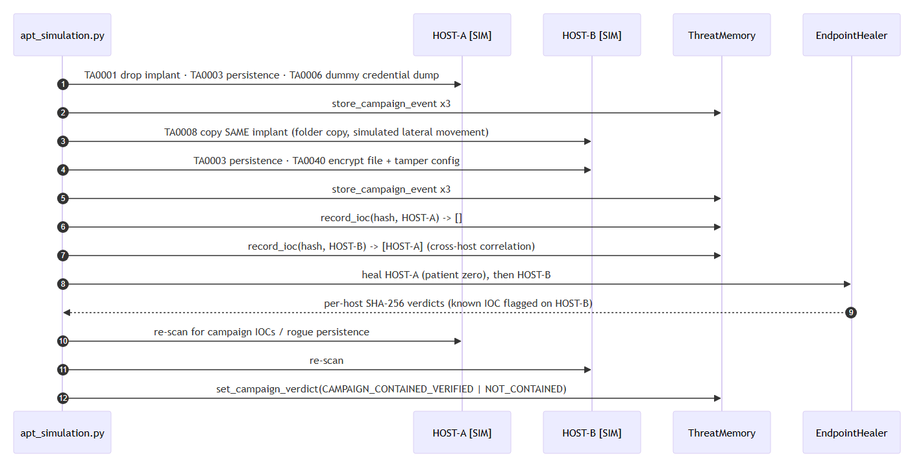

*APT campaign sequence: stages are recorded in threat memory, the implant hash is correlated across
hosts, both hosts are healed, and the final re-scan sets the campaign verdict.*

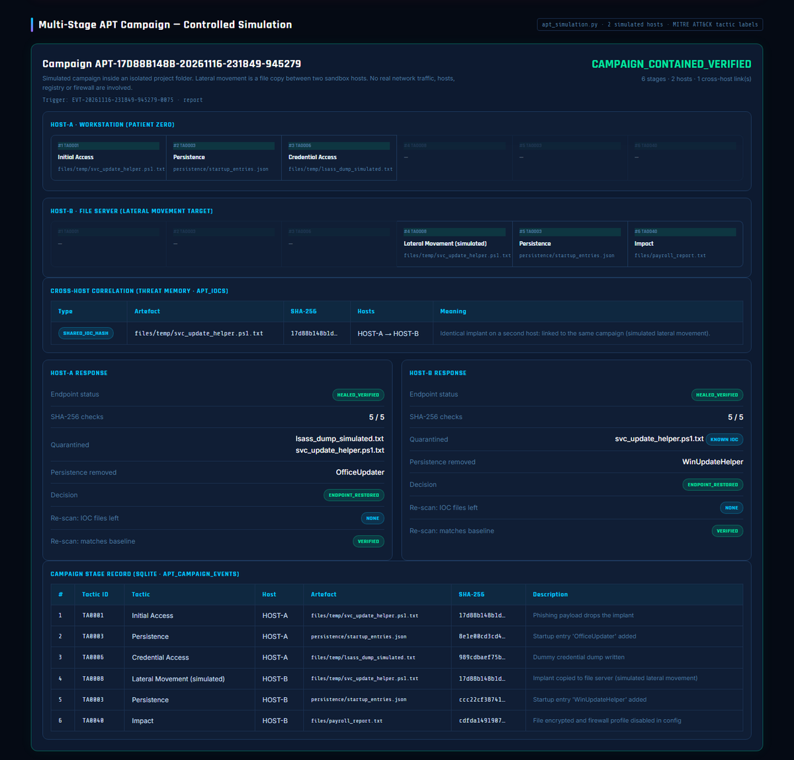

## SOC dashboard

`pipeline.py` writes `runs/<RUN_ID>/dashboard.html`, validates that every event belongs to that
run, and opens it in Chrome or the default browser. Chart.js and fonts are bundled, so it works
offline. Tabs: Overview · ML Model · RL Agent · Results · Pipeline · Self-Healing · Endpoint Healing ·
Threat Intel. Historical training figures are tagged as historical; current-run figures come from
the run's own CSV, summary, SQLite database and endpoint reports.

| Pipeline and frozen policy | Self-healing and recovery | Threat intelligence |
|---|---|---|
| 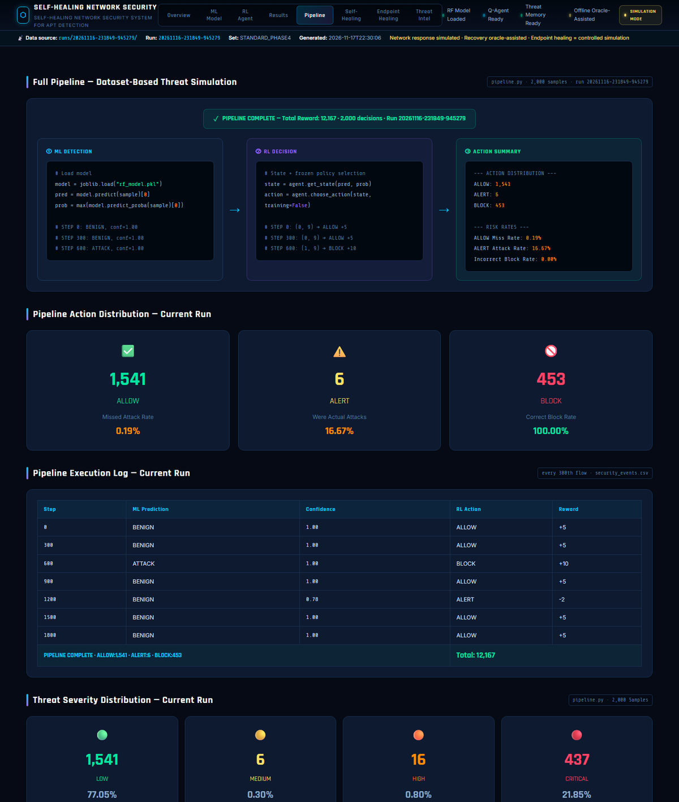 | 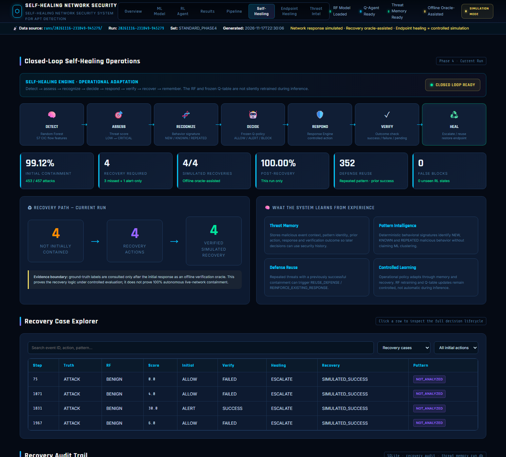 | 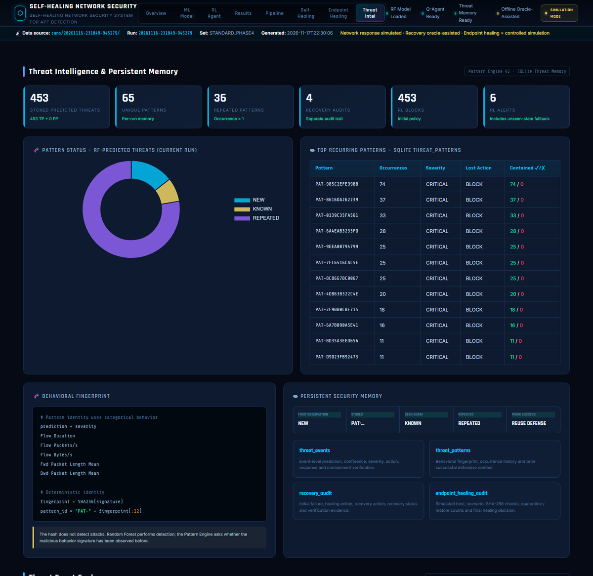 |

A complete example dashboard generated by a real run is included:
**[examples/sample_run/dashboard.html](examples/sample_run/dashboard.html)**. Open it locally in a
browser after cloning; no dataset is needed.

## Installation

```bash
git clone <repository-url>
cd self-healing-apt-security
python -m venv .venv
# Windows: .venv\Scripts\activate      Linux/macOS: source .venv/bin/activate
pip install -r requirements.txt
python project_config.py        # checks inputs; "INPUTS OK" once the dataset is in place
```

Tested with Python 3.14.5 on Windows 11. Versions are pinned because `models/rf_model.pkl` is a
pickled scikit-learn 1.8.0 model.

**Windows note:** the endpoint simulation creates nested files under `runs/`. Keep the clone's
base path under ~120 characters (e.g. `C:\src\self-healing-apt-security`) or enable Windows
long-path support; otherwise file operations can fail with `FileNotFoundError` (MAX_PATH).

## Dataset

The detector expects a parquet file at **`data/cic-collection.parquet`**. It is not included,
because of its size (~1 GB) and third-party licence.

| Requirement | Value |
|---|---|
| Rows used | 9,167,581 flows |
| Columns | 57 numeric CICFlowMeter flow features + `Label` + `ClassLabel` |
| `Label` | `Benign` or an attack name (e.g. `DDoS-LDAP`, `DoS-Hulk`, `Bruteforce-SSH`, `Portscan`) |
| Origin | Merged CIC collection of **CIC-IDS2017**, **CSE-CIC-IDS2018** and **CIC-DDoS2019** flows |

Official sources: [CIC-IDS2017](https://www.unb.ca/cic/datasets/ids-2017.html) ·
[CSE-CIC-IDS2018](https://www.unb.ca/cic/datasets/ids-2018.html) ·
[CIC-DDoS2019](https://www.unb.ca/cic/datasets/ddos-2019.html) (Canadian Institute for
Cybersecurity, University of New Brunswick). The file used in this project is a pre-merged
collection of these datasets: its 33 `Label` values include CIC-IDS2017/CSE-CIC-IDS2018 attacks
(e.g. `DoS-Hulk`, `DDoS-HOIC`, `Bruteforce-SSH`) and CIC-DDoS2019 attacks (e.g. `DDoS-LDAP`,
`DDoS-NTP`, `DDoS-UDPLag`). Any parquet with the same 57 feature columns plus `Label` and
`ClassLabel` works. Cite the original CIC papers when using the data.

Optional, for `training/train_unsw_baseline.py`: the official
[UNSW-NB15](https://research.unsw.edu.au/projects/unsw-nb15-dataset) training and testing CSVs in
`data/unsw/`.

**What needs the dataset:** `pipeline.py`, the evaluation scripts and the training scripts.
**What does not:** `demo.py`, `demo_endpoint_healing.py`, `apt_simulation.py`, the tests, and the
example dashboard.

## Usage

```bash
# 1. End-to-end demonstration, no dataset needed (a few seconds):
#    tests -> endpoint healing (success + failure) -> APT campaign -> dashboard
python demo.py

# 2. Full standard run on 2,000 flows (needs the dataset; under ~2 minutes):
#    detection -> RL -> verification -> recovery -> endpoint + APT -> dashboard opens
python pipeline.py
python pipeline.py --sample-size 20 --no-browser      # quick live smoke run (~45 s)

# 3. Held-out evaluation (2,000 flows with 0 overlap with the RL training rows)
python evaluate_self_healing_heldout.py

# 4. Evaluation report: overlap disclosure, RL vs baseline, unseen states,
#    failure paths, pattern-reuse analysis -> runs/<RUN_ID>-evaluation/
python evaluate_project.py

# 5. Re-render the dashboard of an existing run from its saved outputs
python dashboard_export.py runs/<RUN_ID> --open

# 6. Individual simulations
python demo_endpoint_healing.py
python apt_simulation.py
```

Every command writes only to a new `runs/<RUN_ID>/` folder with a fresh database. The model and
Q-table are read-only. The training scripts write to `models/retrained/` and never overwrite the
shipped models; the original 80/20 RF split had no seed, so retraining will not reproduce the
shipped model exactly.

## Model artifacts

| File | Content | Produced by | SHA-256 |
|---|---|---|---|
| `models/rf_model.pkl` | scikit-learn 1.8.0 `RandomForestClassifier` (50 trees, 57 features) | `training/train_random_forest.py` | `3a9d386bf1f8fbdb09a5a160cf091b32503e56cd692080dcb0d4cfa10eb684ce` |
| `models/q_table.pkl` | Python dict: 9 states × {ALLOW, ALERT, BLOCK} Q-values | `training/train_q_learning.py` | `d109dc619ecff083ca02601c11970de15efe9ba482224de3b350b7ea2cc310d5` |

> **Security note:** both files are Python pickles (via `joblib`). Unpickling can execute
> arbitrary code, so **only load model files from a source you trust.** Verify the hashes above
> (`certutil -hashfile models\rf_model.pkl SHA256` on Windows, `sha256sum` on Linux/macOS) and
> never load pickles downloaded from elsewhere.

The models are trained on CIC data. Use of the data and derived models remains subject to the
dataset publishers' terms.

## Database

Each run creates its own SQLite database (`runs/<RUN_ID>/threat_memory_run.db`; the demo uses
`runs/<RUN_ID>-demo/demo.db`). No database files are committed. The schema is generated from
`threat_memory.py` and documented in **[database/schema.sql](database/schema.sql)**:

| Table | Content |
|---|---|
| `threat_events` | RF-predicted threats: prediction, confidence, score, severity, RL state/action, response, verification, pattern |
| `threat_patterns` | Behavioural fingerprints, occurrence counts, prior containment successes/failures |
| `recovery_audit` | Attacks needing recovery: initial action, healing decision, recovery action and status |
| `endpoint_healing_audit` | Simulated host, scenario, SHA-256 results, quarantine/restore counts, final decision |
| `apt_campaigns`, `apt_campaign_events`, `apt_iocs` | Campaign verdict, ordered MITRE-labelled stages, IOC hashes and hosts seen |

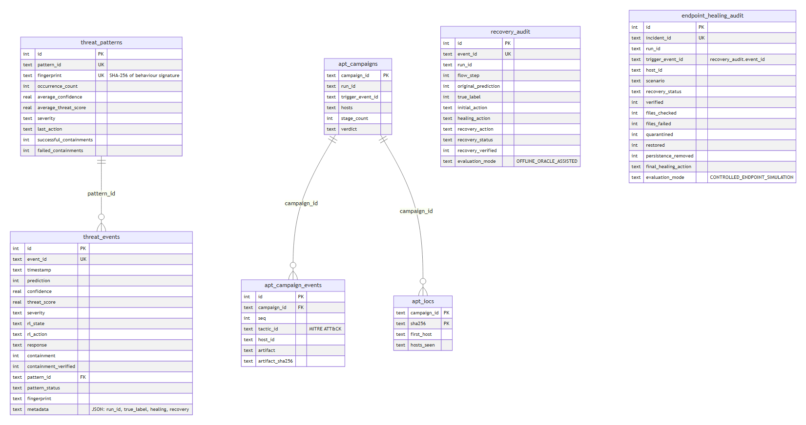

*The schema declares no FOREIGN KEY constraints. The dashed arrows are logical links: the
application writes matching values. `recovery_audit.event_id` matches a `threat_events` row only
when the Random Forest flagged that flow. Tables marked "created on first use" appear once the
endpoint or APT simulation runs.*

## Tests

```bash
python -m unittest discover -s tests -v      # 53 tests, temporary folders only
```

Coverage: verifier (10 cases), healing engine (9), pattern engine, threat memory and audits, RL
state/reward/frozen evaluation, threat-assessment thresholds, held-out split (zero overlap), path
guards, endpoint healing (success, corrupted backup, tampered manifest, sandbox escape), APT
campaign (success and failure), and dashboard export and validation.

## Results

Run on the merged CIC flow collection described above. **Held-out results are the evaluation of
record.**

**Data overlap (disclosed).** The standard 2,000-flow sample (`random_state=42`) is also the RL
training sample, and it lies inside the Random Forest's 100k training sample. **Standard-run
figures are therefore in-sample.** The held-out sample has 0 overlap with the RL training rows
(28 of its rows fall inside the RF's 100k sample).

| Random Forest | In-sample standard | **Held-out** |
|---|---|---|
| Accuracy | 99.80 % | **98.90 %** |
| Precision (attack) | 100.00 % | **98.99 %** |
| Recall (attack) | 99.12 % | **95.63 %** |
| F1 (attack) | 99.56 % | **97.28 %** |
| TP / TN / FP / FN | 453 / 1,543 / 0 / 4 | 394 / 1,584 / 4 / 18 |

Historical training-time result: 19,695 / 20,000 correct on the original 20 % test split. A
*separate* Random Forest trained and tested on UNSW-NB15 reached 90.43 %; this is second-dataset
evidence, not a cross-dataset test of the CIC model.

| Response policy (held-out) | Reward | Attacks allowed | Unnecessary alerts | False blocks |
|---|---|---|---|---|
| Frozen Q-learning | **11,420** | 17 | 21 | 4 |
| Baseline: follow the classifier | **11,550** | 18 | 0 | 4 |
| Oracle (upper bound) | 12,060 | 0 | 0 | 0 |

The learned policy differs from the baseline only on 22 flows the classifier predicted benign
with low confidence, where it alerts. It catches one extra attack but adds 21 unnecessary alerts,
so **it does not beat the simple baseline on reward**. With a state of only (prediction,
confidence), RL adds caution rather than reward.

| Simulated containment | Initial | After oracle-assisted recovery |
|---|---|---|
| In-sample standard | 99.12 % | 100 % (4/4) |
| **Held-out** | **95.63 %** | **100 % (18/18)** |

Recovery uses ground truth after the action, so 100 % shows that the recovery logic works in
offline evaluation; it is not live detection of failed containment. Pattern reuse fired on 303
held-out threats but only after verified successes with the same action, so it changes neither
reward nor containment.

| Controlled simulation | Verdict |
|---|---|
| Endpoint, intact backup | HEALED_VERIFIED · 5/5 SHA-256 |
| Endpoint, corrupted backup | HEALING_INCOMPLETE · 4/5 · SOC_REVIEW |
| 6-stage campaign, HOST-A → HOST-B | CAMPAIGN_CONTAINED_VERIFIED · both hosts 5/5 · re-scan clean |

## Limitations and future work

**Limitations**
- Standard-run figures are in-sample; held-out figures are the ones to quote.
- Recovery is oracle-assisted (offline ground truth), not live detection of failed responses.
- Responses are simulated: **no firewall rules are enforced and no real Windows endpoint is repaired.**
- Endpoint compromise and lateral movement are file-level simulations in an isolated folder.
- The RL state is coarse (9/20 states learned) and does not beat a classifier-following baseline.
- Detection is per flow; multi-stage correlation exists only in the simulation.
- No rollback for false blocks; LIVE verification is an interface without telemetry.

**Future work:** live flow capture (e.g. CICFlowMeter) → detector; firewall/EDR API enforcement
with telemetry that confirms the traffic stopped; rollback of disruptive actions; a richer RL state
(severity, pattern status, host context) evaluated against the baseline; host/time correlation of
real flows; seeded retraining for a fully leakage-free benchmark.

## Repository structure

```
├── pipeline.py                     # main run: detection → RL → verify → recover → endpoint → APT → dashboard
├── demo.py                         # dataset-free end-to-end demonstration
├── project_config.py               # paths, per-run folders, write guard
├── rl_agent.py                     # Q-learning agent and reward function
├── threat_assesment.py             # threat score and severity
├── pattern_engine.py               # behavioural fingerprints
├── threat_memory.py                # SQLite threat memory and audit tables
├── response_engine.py              # simulated ALLOW / ALERT / BLOCK
├── response_verifier.py            # SIMULATED / LIVE / ENDPOINT_INTEGRITY verification
├── self_healing_engine.py          # healing decisions
├── endpoint_healing.py             # controlled endpoint healing (SHA-256)
├── apt_simulation.py               # 6-stage, 2-host APT campaign
├── dashboard_export.py             # run-driven dashboard generation and validation
├── evaluate_self_healing_heldout.py
├── evaluate_project.py
├── demo_endpoint_healing.py
├── models/                         # rf_model.pkl (frozen RF), q_table.pkl (frozen policy)
├── training/                       # scripts that produced the models (write to models/retrained/)
├── dashboard/                      # SOC dashboard template + bundled Chart.js and fonts
├── database/schema.sql             # SQLite schema
├── examples/sample_run/            # dashboard generated by a real standard run
├── tests/                          # 53 unit and integration tests
├── assets/                         # screenshots and diagrams for this README
├── third_party_licenses/           # Chart.js (MIT) and font (SIL OFL 1.1) licence texts
├── LICENSE                         # MIT License
├── NOTICE.txt                      # licence scope and bundled third-party components
└── data/                           # place the dataset here (not committed)
```

The Python modules sit at the top level because they import each other directly; this keeps the
verified code unchanged.


## Project Team

This project was developed as part of the **B.Tech in Artificial Intelligence and Data Science** program at **K. J. Somaiya School of Engineering, Somaiya Vidyavihar University, Mumbai**.

### Group Members

- **Nikunj Mody**
- **Swaraj Patil**
- **Jash Prajapati**
- **Kevalya Rathod**

### Academic Guide

**Prof. Deepti Patole**

## Acknowledgements

Developed in an academic setting as a final-year B.Tech (Artificial Intelligence and Data Science)
project at K. J. Somaiya School of Engineering, Somaiya Vidyavihar University, Mumbai, with
academic guidance from Prof. Deepti Patole. This is a personal portfolio repository; it is not
an official publication of, or endorsed by, the institution.

Datasets © Canadian Institute for Cybersecurity and UNSW Canberra Cyber.

## License

The project's own code is released under the **MIT License** ([LICENSE](LICENSE)).
Bundled third-party components keep their own licences, which the MIT licence does not replace:
Chart.js v4.4.1 (MIT, © Chart.js Contributors) and the Inter, Rajdhani and Share Tech Mono fonts
(SIL Open Font License 1.1). The scope is described in [NOTICE.txt](NOTICE.txt); full licence
texts are in [third_party_licenses/](third_party_licenses/) (see also
[dashboard/vendor/NOTICE.txt](dashboard/vendor/NOTICE.txt)).
